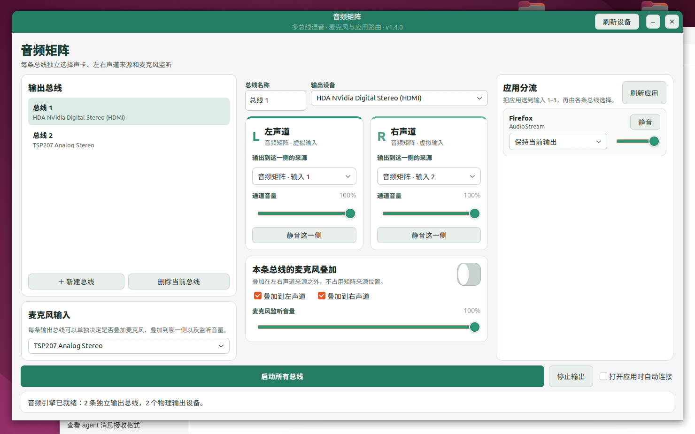

# 音频矩阵

[](https://github.com/phecda000/audio-matrix/actions/workflows/tests.yml)
[](LICENSE)

这是一个面向 Ubuntu / PulseAudio 的独立桌面音频调音台，整合了应用分流、麦克风监听和左右声道矩阵，不再依赖 Pulsemeeter。



## 主要功能

- 自动创建 3 个虚拟输入：`输入 1`、`输入 2`、`输入 3`。
- 列出当前正在播放的应用，把每个应用单独送入任意虚拟输入。
- 保存应用分流规则，应用再次出现时自动恢复。
- 分别为左声道和右声道选择来源。
- 左右声道独立调整音量和静音。
- 创建任意数量的独立输出总线，分别选择耳机、音箱、HDMI 或 USB 声卡。
- 每条总线拥有独立的左右声道来源、音量、静音和麦克风叠加设置。
- 固定 1480×925（16:10）单页工作台，左侧选择总线，中间编辑声道，右侧管理应用。
- 主要信息无需拖动窗口或操作外层滚动条。
- 麦克风可在矩阵之外叠加到左、右或两侧。
- 立体声来源会先合并成完整单声道，再放入目标声道。
- 关闭程序时只清理“音频矩阵”创建的 PulseAudio 模块。

## 使用方法

1. 打开“音频矩阵”。
2. 在“应用分流”中，把不同应用分别送到输入 1、输入 2 或输入 3。
3. 在“输出总线 / 麦克风”页中，为每条总线选择声卡与左右声道来源。
4. 使用“新建总线”和“删除当前总线”管理不同的独立输出。
5. 每条总线可单独调整音量、静音，并决定是否叠加麦克风。
6. 选择公共麦克风输入，然后点击“启动所有总线”。

应用进入虚拟输入后不会直接送往声卡，而是由左右声道矩阵控制。

例如可以把总线 1 设为 HDMI 的“输入 1 / 输入 2”，把总线 2 设为 USB 声卡的“输入 3 / 输入 1”，两条总线会独立工作。

## 安装

```bash
./install.sh
```

安装不需要管理员权限。安装完成后可从应用菜单搜索 **音频矩阵**，或运行：

```bash
audio-matrix
```

## 配置

配置保存在：

```text
~/.config/audio-matrix/config.json
```

## 运行要求

- Ubuntu 与 PulseAudio
- GTK 3 和 PyGObject
- `pactl`、`paplay`

如果旧的 Pulsemeeter 已经退出但留下虚拟设备，“音频矩阵”会自动清理这些遗留模块。若 Pulsemeeter 仍在运行，应用会提示先关闭它。

## 开发与测试

```bash
PYTHONPATH=src python3 -m unittest discover -s tests -v
```

## License

[MIT](LICENSE)
